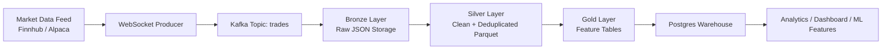
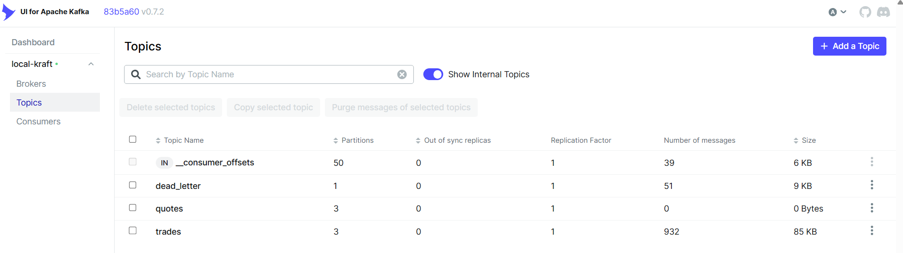
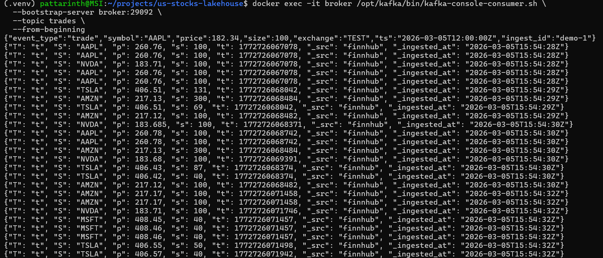
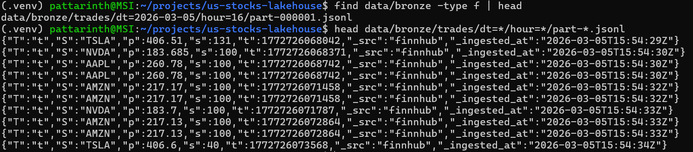
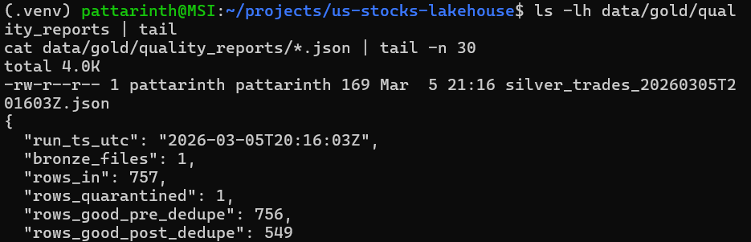
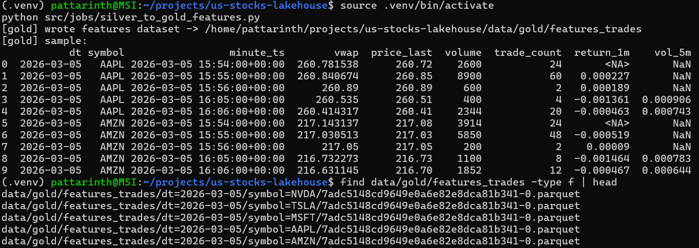
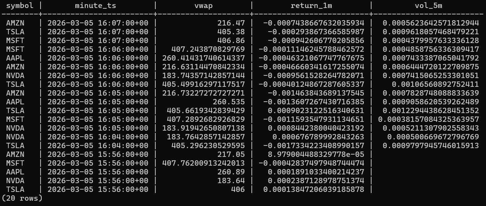
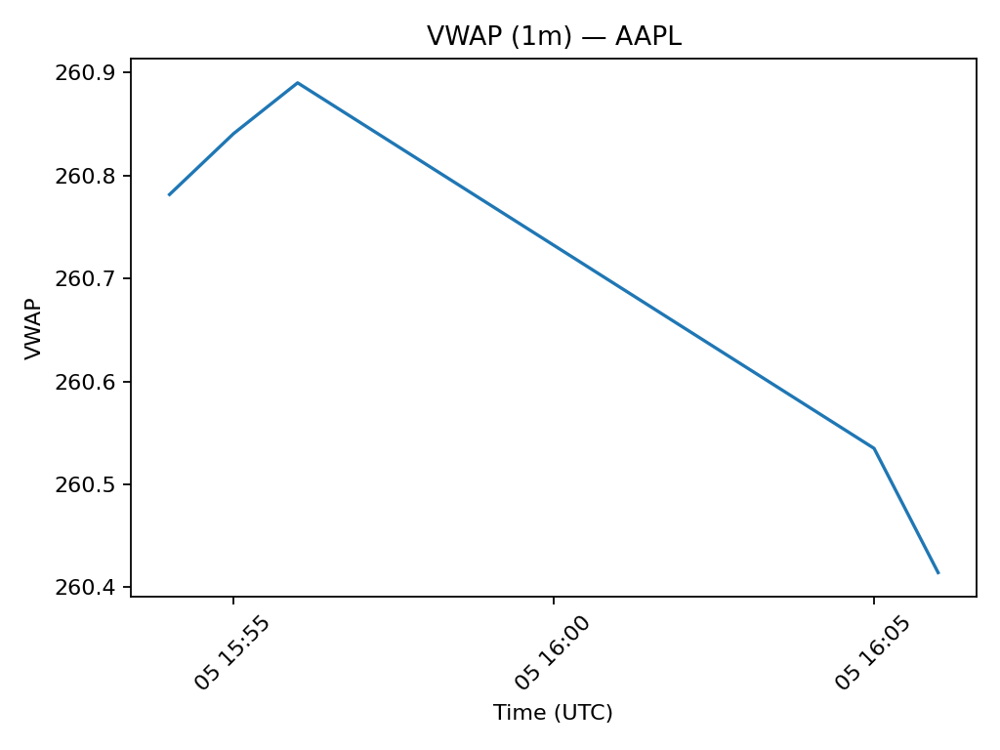
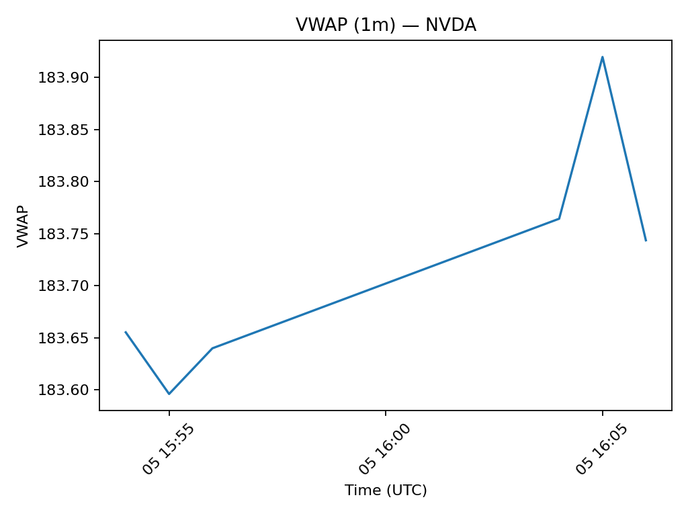

# Real-Time US Stock Market Data Lakehouse  
### Kafka → Bronze / Silver / Gold → Feature Tables → Postgres

A real-time data engineering pipeline that ingests live stock market trades, processes them through a **Lakehouse architecture**, and produces analytics-ready features for downstream querying.

This project demonstrates **streaming ingestion, schema enforcement, deduplication, lakehouse layering, feature engineering, and warehouse serving** using open-source tools.

## Key Highlights

- Real-time WebSocket ingestion
- Kafka streaming pipeline
- Lakehouse architecture (Bronze / Silver / Gold)
- Schema enforcement and data quality monitoring
- Deduplication and idempotent processing
- Financial feature engineering (VWAP, returns, volatility)
- Warehouse serving using Postgres

## Project Summary

This project builds a **real-time stock market data lakehouse pipeline** using Kafka and Python.

Key capabilities demonstrated:

- Real-time WebSocket data ingestion
- Streaming pipeline using Kafka
- Lakehouse architecture (Bronze / Silver / Gold)
- Schema enforcement and data quality checks
- Deduplication and idempotent processing
- Feature engineering for financial time-series
- Data warehouse serving with Postgres
---

# Architecture


> The pipeline follows a modern lakehouse architecture separating raw ingestion, cleaned datasets, and analytics-ready feature tables.
---

# Tech Stack

| Layer | Technology |
|------|-------------|
Streaming | WebSocket + Kafka |
Processing | Python + Pandas |
Storage | Parquet Lakehouse |
Warehouse | Postgres |
Visualization | Matplotlib |
Containerization | Docker |

---

# Pipeline Overview

The pipeline follows a **Lakehouse architecture**:

| Layer | Description |
|------|-------------|
Bronze | Raw streaming events stored exactly as received |
Silver | Cleaned dataset with schema enforcement and deduplication |
Gold | Aggregated feature tables for analytics and ML |

---

# Step 1 — Streaming Market Data → Kafka

Real-time trades are ingested from a WebSocket stream and published to a Kafka topic.

**Kafka Topics**



**Live data streaming into Kafka**



Example event:

```json
{
  "T": "t",
  "S": "AAPL",
  "p": 260.78,
  "s": 100,
  "t": 1772726068742
}
```

---

# Step 2 — Bronze Layer (Raw Lake Storage)

Bronze stores **raw immutable events** exactly as received.

Directory structure:

```
data/bronze/trades/
  dt=2026-03-05/
    hour=16/
      part-000001.jsonl
```

Example raw output:



Purpose:

- replayability
- auditing
- schema evolution tolerance

---

# Step 3 — Silver Layer (Clean + Deduplicated Data)

The Silver layer performs:

- schema enforcement
- type casting
- data validation
- deduplication
- quarantine of invalid rows

Invalid events are isolated into a quarantine dataset.

### Data Quality Report

Each run generates a quality report containing ingestion metrics.



Example metrics:

```
rows_in
rows_quarantined
rows_good_pre_dedupe
rows_good_post_dedupe
```

This provides **observability and monitoring of pipeline health**.

---

# Step 4 — Gold Layer (Feature Engineering)

Gold tables contain **analytics-ready features** aggregated per symbol per minute.

Computed features include:

| Feature | Description |
|------|-------------|
VWAP | Volume Weighted Average Price |
return_1m | 1-minute return |
vol_5m | rolling 5-minute volatility |
trade_count | trades per minute |
volume | traded volume |

Partitioned Gold dataset:

```
data/gold/features_trades/
  dt=2026-03-05/
    symbol=AAPL/
    symbol=NVDA/
```



---

# Step 5 — Warehouse Serving (Postgres)

Gold features are loaded into a Postgres table for analytics.

Example query output:



Example SQL query:

```sql
SELECT symbol,
       minute_ts,
       vwap,
       return_1m,
       vol_5m
FROM features_trades
ORDER BY minute_ts DESC
LIMIT 20;
```

---

# Feature Visualization

Example VWAP charts generated from the warehouse.

### AAPL VWAP



### NVDA VWAP



---

# Project Structure

```
us-stocks-lakehouse
│
├── docker-compose.yml
├── README.md
│
├── data
│   ├── bronze
│   ├── silver
│   ├── gold
│   └── quarantine
│
├── src
│   ├── producer
│   │   └── finnhub_ws_to_kafka.py
│   │
│   ├── consumers
│   │   └── kafka_to_bronze_trades.py
│   │
│   ├── jobs
│   │   ├── bronze_to_silver_trades.py
│   │   ├── silver_to_gold_features.py
│   │   └── gold_to_postgres.py
│   │
│   └── analytics
│       └── plot_vwap.py
│
└── docs
    └── screenshots
```

---

# Running the Pipeline

### 1 Start infrastructure

```
docker compose up -d
```

### 2 Start the streaming producer

```
python src/producer/finnhub_ws_to_kafka.py
```

### 3 Run Bronze ingestion

```
python src/consumers/kafka_to_bronze_trades.py
```

### 4 Run Silver transformation

```
python src/jobs/bronze_to_silver_trades.py
```

### 5 Build Gold feature tables

```
python src/jobs/silver_to_gold_features.py
```

### 6 Load warehouse

```
python src/jobs/gold_to_postgres.py
```

---

# Design Highlights

### Streaming ingestion
WebSocket → Kafka enables decoupled real-time ingestion.

### Lakehouse layering
Bronze → Silver → Gold structure improves reliability and observability.

### Deduplication strategy
Event key:

```
symbol | timestamp | price | size
```

ensures idempotent processing.

### Partitioning strategy

```
dt=YYYY-MM-DD
symbol=TICKER
```

Benefits:

- faster queries
- lower storage scan cost
- efficient pruning

---

# Data Source Note

This project is designed to be **feed-agnostic**.

During development, a free real-time market feed is used.

Production systems may ingest data from providers such as:

- :contentReference[oaicite:0]{index=0}
- :contentReference[oaicite:1]{index=1}

The pipeline architecture remains identical regardless of the source.

---

# Limitations

- simplified streaming scale (single-node Kafka)
- limited symbol universe
- batch-style Gold computation rather than streaming aggregation

---

# Future Improvements

Potential enhancements:

- Spark Structured Streaming
- Kafka Schema Registry
- Airflow orchestration
- Delta Lake or Iceberg tables
- Feature Store integration
- real-time dashboard with Grafana or Superset

---

# Key Takeaways

This project demonstrates core data engineering capabilities:

- streaming data ingestion
- message queue processing
- lakehouse architecture
- schema enforcement and data quality checks
- deduplication and idempotent pipelines
- feature engineering
- warehouse serving for analytics

---
## Why This Project Matters

Many beginner data projects focus on static CSV analysis.  
This project demonstrates a **production-style data engineering pipeline**, including streaming ingestion, layered lakehouse storage, feature engineering, and warehouse serving.

The architecture closely mirrors pipelines used in modern data platforms and quantitative finance environments.

---
# License

MIT License

## Author

**Pattarin Thunyapar**

Data Analytics & Data Engineering  
Berlin, Germany